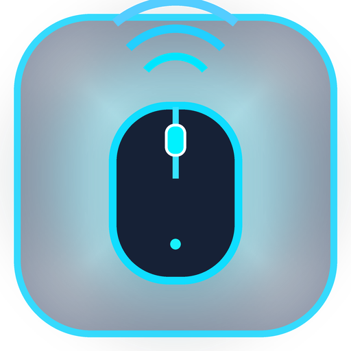

<h1 align="center">
  
    
  
   
  MouseSense
</h1>

  <b>High-Performance Wireless PC Mouse, Keyboard &amp; Trackpad</b> 
  Developed by <b>IT Amadersomaj Inc</b>

  
  
  
  

---

## 📌 Description

**MouseSense** is a modern, high-precision cross-platform remote input utility engineered by **IT Amadersomaj Inc**. It turns any Android smartphone or tablet into a fluid wireless trackpad, sensitive mouse, and full multimedia keyboard for your computer.

With triple connectivity—**Wi-Fi Auto-Discovery**, standard **Bluetooth HID**, and high-speed **USB (ADB)**—MouseSense delivers responsive cursor tracking, natural multi-touch gestures, zero-latency typing, and smart automatic reconnection.

---

## 🚀 Key Improvements in v2.0 (IT Amadersomaj Inc Release)

* ⚡ **Instant Wi-Fi Auto-Discovery:** No manual IP configuration required. The MouseSense PC Server and Android client discover each other automatically over your local network using UDP broadcast beacons (`MOUSESENSE_DISCOVER` / `MOUSESENSE_BEACON` on port `6969`).
* 📶 **Full Bluetooth HID & Active Discovery:** Integrated active Bluetooth device discovery (`BluetoothAdapter.startDiscovery()`) and modern Android 12, 13, and 14 permission support (`BLUETOOTH_SCAN`, `BLUETOOTH_CONNECT`, `BLUETOOTH_ADVERTISE`).
* 🔄 **Smart Auto-Connect:** Remembers your last-connected computer and automatically reconnects upon launching Wi-Fi or Bluetooth mode.
* 🎨 **Deep Obsidian & Cyber-Cyan UI/UX:** Premium dark aesthetic (`#0B0F19` obsidian background, `#162036` frosted slate cards, `#00E5FF` electric cyan accents) crafted for OLED displays and low eye strain.
* 🛡️ **Robust Connection Lifecycle:** Seamless background thread handling, Android `MulticastLock` integration, and automatic state recovery.

---

## 🌟 Features Overview

* **Three Versatile Connection Modes:**
  * **Wi-Fi Mode:** Automatic zero-config discovery over local Wi-Fi with ultra-low latency UDP event streaming.
  * **Bluetooth HID Mode:** Emulates standard Bluetooth HID hardware—works directly with your computer without needing any server installed!
  * **USB (ADB Wired) Mode:** Direct wired connection via USB cable using Android Debug Bridge reverse forwarding.
* **Multi-Touch Trackpad:** Smooth cursor acceleration, tap-to-click, two-finger right click, two-finger vertical/horizontal scrolling, and drag-and-drop.
* **Full Keyboard & Numpad:** Virtual QWERTY keyboard with special modifier keys (Ctrl, Alt, Shift, Esc, Tab, Arrow keys) and an accounting-grade Numpad.
* **Media & Presentation Controls:** Quick-access volume controls, play/pause, media seek, and presentation slide controls.
* **Windows PC Companion:** Standalone Windows desktop server (`MouseSense.exe`) featuring system tray minimization, adjustable move/scroll sensitivity, and Windows startup integration.

---

## 👆 Gesture Guide

| Action | Gesture |
| :--- | :--- |
| **Move Cursor** | Slide one finger across the touchpad surface |
| **Left Click** | Tap with one finger |
| **Double Click** | Double tap with one finger |
| **Right Click** | Tap with two fingers (or tap the Right Click area) |
| **Vertical / Horizontal Scroll** | Drag up/down or left/right with two fingers |
| **Drag &amp; Drop** | Long press until highlighted, then slide to move |
| **Pinch to Zoom** | Pinch in or spread two fingers |

---

## 📥 Deliverables & Downloads

* **GitHub Release Page:** [MouseSense v2.0.0 Release](https://github.com/mohammad-sheikh-shahinur-rahman/MouseSense/releases/tag/v2.0.0)
* **Android Mobile App (APK):**
  * Direct Download: [MouseSense.apk (v2.0.0)](https://github.com/mohammad-sheikh-shahinur-rahman/MouseSense/releases/download/v2.0.0/MouseSense.apk)
  * Local File: [`MouseSense.apk`](file:///J:/Mousedroid/MouseSense.apk) (13.2 MB)
* **Windows PC Server (Portable Distribution):**
  * Direct Download: [MouseSense_v2.0_Windows_x64.zip](https://github.com/mohammad-sheikh-shahinur-rahman/MouseSense/releases/download/v2.0.0/MouseSense_v2.0_Windows_x64.zip)
  * Local Folder: [`MouseSense_PC`](file:///J:/Mousedroid/MouseSense_PC/) | Executable: [`MouseSense.exe`](file:///J:/Mousedroid/MouseSense_PC/MouseSense.exe)

---

## 🚀 Quick Start Guide

### 🌐 Method A: Wi-Fi Mode (Recommended)

1. Connect your PC and phone to the **same Wi-Fi network**.
2. Run [`MouseSense.exe`](file:///J:/Mousedroid/MouseSense_PC/MouseSense.exe) on your computer.
3. Open the **MouseSense** app on your phone and tap **Wi-Fi Mode**.
4. The app will automatically detect your PC and connect immediately.

---

### 🔵 Method B: Bluetooth Mode (No Network Required)

1. Turn on Bluetooth on your PC and Android phone.
2. In the app, tap **Bluetooth Mode** &rarr; tap **Pair New** or pick your PC from the discovered devices list.
3. Accept the pairing confirmation on your PC.
4. Your Android device now acts as a native hardware Bluetooth mouse and keyboard!

---

### 🔌 Method C: USB Mode (Near-Zero Latency)

1. Enable **USB Debugging** on your phone (*Settings &rarr; System &rarr; Developer Options &rarr; USB Debugging*).
2. Connect your phone to the PC via USB.
3. Launch [`MouseSense.exe`](file:///J:/Mousedroid/MouseSense_PC/MouseSense.exe) on your PC and click **Start ADB**.
4. Tap **Connect** in the Android app.

---

## 🔧 Troubleshooting

| Symptom | Probable Cause | Recommended Resolution |
| :--- | :--- | :--- |
| **PC not detected on Wi-Fi** | Windows Defender Firewall blocking port `6969` | Allow `MouseSense.exe` through Windows Defender Firewall for Private and Public networks. |
| **Wi-Fi AP Isolation** | Router prevents peer-to-peer traffic | Disable "AP Isolation" or "Client Isolation" in your Wi-Fi router's admin panel. |
| **Bluetooth pairing fails** | Missing Android 12+ permissions | Ensure "Nearby devices" permission is granted to **MouseSense** in *App Info &rarr; Permissions*. |
| **USB mode not detected** | ADB authorization pending | Unlock your phone screen and tap "Always allow from this computer" when prompted. |

---

## 🏢 About IT Amadersomaj Inc

**IT Amadersomaj Inc** builds modern digital utilities and productivity software tailored for speed, reliability, and seamless cross-device workflows.

* **Project:** MouseSense
* **Company:** IT Amadersomaj Inc
* **License:** [MIT License](LICENSE)

  &copy; 2026 IT Amadersomaj Inc. All rights reserved.

